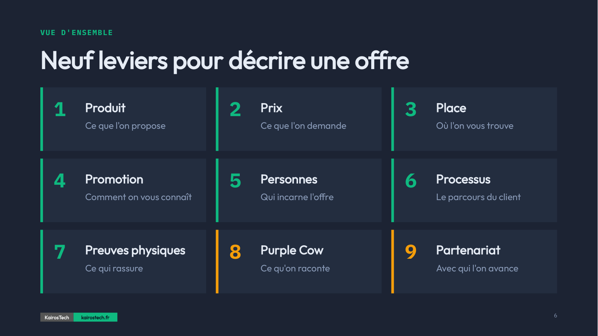

*Le marketing mix expliqué simplement : des 4P aux 9P, neuf questions à poser à une offre, un projet ou une idée.*

# Le marketing mix en 9P : des 4P aux 9P

## De quoi s'agit-il ?

Une formation courte sur le marketing mix, pour les personnes qui doivent faire adopter une offre sans avoir fait d'école de commerce : fondateurs, ingénieurs, chercheurs, chefs de projet.

Le marketing mix rassemble les leviers que l'on règle pour qu'une offre trouve son public. Le modèle d'origine en compte quatre, les 4P. Le marketing des services en ajoute trois, ce qui donne les 7P. Cette formation en ajoute deux autres, d'où les 9P. 
Chaque P est traité en trois diapositives : la question à se poser, un exemple concret, l'erreur que l'on voit le plus souvent.

  

**[Lire la formation (PDF)](formation/Marketing_Mix_9P.pdf)** · [PowerPoint modifiable](formation/Marketing_Mix_9P.pptx) · [Fiche A4 des neuf questions](formation/Fiche_9P_A4.pdf) · [Guide animateur](animation/guide-animateur.md) · [Exercices](exercices/) · [Site de la formation](https://maximerumpler.github.io/Marketing_Mix_9P/)

* * *

## Ce que vous saurez faire

À la fin de la formation, vous pourrez :

- situer les 4P, les 7P et les 9P, et dire d'où vient chaque ajout (diapositives 4 et 5) ;
- poser la question clé de chacun des neuf P à votre propre offre (diapositives 7 à 33) ;
- reconnaître l'erreur la plus fréquente sur chaque levier ;
- expliquer pourquoi un changement sur un P oblige à vérifier les autres (diapositive 34) ;
- passer un projet entier à la grille des neuf questions (diapositive 35).

* * *

## Les 9P en un coup d'œil

Les sept premiers P forment le modèle classique du marketing des services. Les P 8 et 9 sont des bonus, hors du modèle académique.

| | Levier | Question à se poser | Exemple de la formation | Erreur fréquente |
|:-:|:--|:--|:--|:--|
| 1 | **Produit** | Quel besoin mon offre résout-elle vraiment ? | 1970 : la valise apprend à rouler | Ajouter des fonctions plutôt que répondre au besoin |
| 2 | **Prix** | Quel prix le client accepte-t-il, et que dit-il de ma valeur ? | L'imprimante coûte peu, l'encre fait la marge | Fixer le prix à partir du coût, pas de la valeur |
| 3 | **Place** | Où et comment le client accède-t-il à mon offre ? | Le colis vient sur le trajet du client | Multiplier les canaux sans cohérence |
| 4 | **Promotion** | Comment faire connaître et désirer mon offre ? | Une seule image a fait le tour du monde (le trou noir de 2019) | Décrire la technologie au lieu du bénéfice |
| 5 | **Personnes** | Qui délivre l'offre, et avec quelle qualité de contact ? | Le vendeur qui regarde courir avant de conseiller | Négliger les personnes au contact du client |
| 6 | **Processus** | Quel parcours le client traverse-t-il pour en profiter ? | Un vol se prépare depuis le canapé | Laisser des frictions décourager le client |
| 7 | **Preuves physiques** | Quels signaux tangibles rassurent sur la qualité ? | La cuisine ouverte sur la salle | Oublier les preuves quand le client ne peut rien toucher |
| 8 | **Purple Cow** (bonus) | Qu'est-ce qui rend mon offre digne d'être racontée ? | Une colle ratée devenue le Post-it | Confondre « un peu meilleur » et « remarquable » |
| 9 | **Partenariat** (bonus) | Avec qui créer plus de valeur qu'en restant seul ? | La marque de café qui ne fabrique pas ses machines | Signer un partenariat de façade |

* * *

## D'où vient le modèle

| Année | Qui | Apport |
|:-:|:--|:--|
| 1948-1964 | Neil Borden | Parle de « marketing mix » dès la fin des années 1940, puis publie en 1964 l'article qui fixe l'expression |
| 1960 | E. Jerome McCarthy | Ramène le marketing à quatre leviers : Product, Price, Place, Promotion. Ce sont les 4P |
| 1981 | Bernard Booms et Mary Jo Bitner | Ajoutent People, Process et Physical evidence pour les services, d'où les 7P |
| 1996 | Christopher Lovelock | Ses manuels de marketing des services diffusent ces P dans l'enseignement |
| 2003 | Seth Godin | *Purple Cow* : dans un marché saturé, seul ce qui est remarquable se remarque. La formation en fait son 8e P |

Le 9e P, Partenariat, apparaît par exemple chez Alastair Morrison, dans ses 8P du marketing touristique (1989). Il circule depuis dans plusieurs variantes à 8 ou 10P. 

* * *

## Déroulé et formats

| Séquence | Contenu | Diapositives |
|:--|:--|:-:|
| D'où vient le modèle | Soixante ans d'histoire en une minute | 4-6 |
| Les 9P, un par un | Une question, un exemple, une erreur fréquente | 7-33 |
| Un mix, pas une liste | Pourquoi tout se tient | 34 |
| À emporter | Neuf questions à reposer à votre propre cas | 35-36 |

Aucun prérequis. 
Selon l'usage :

- en lecture seule, comptez 20 à 30 minutes ;
- en présentation, la formation est prévue pour 45 minutes, questions comprises ;
- en atelier, chaque P se termine par une question « Et pour vous ? » à laquelle les participants répondent sur leur propre offre : prévoyez alors 1 h 30 à 2 h.

Pour animer, le [guide animateur](animation/guide-animateur.md) donne pour chaque diapositive la question d'ouverture, les relances, les points à retenir et la transition, avec des durées par séquence. Les [exercices](exercices/) proposent un cas fil rouge corrigé, un canevas pour votre propre offre et un quiz. La [fiche A4](formation/Fiche_9P_A4.pdf) reprend les neuf questions sur une page, à distribuer.

* * *

## Questions fréquentes

**Quelle différence entre les 4P, les 7P et les 9P ?**
Les 4P (McCarthy, 1960) couvrent le produit, le prix, la place et la promotion. Les 7P (Booms et Bitner, 1981) ajoutent les personnes, les processus et les preuves physiques, parce qu'un service est immatériel et dépend des gens qui le délivrent. Les 9P de cette formation ajoutent la Purple Cow de Seth Godin et le Partenariat.

**À qui sert le marketing mix ?**
À toute personne qui doit faire adopter quelque chose, que ce soit un produit, un projet ou un budget. Il faut chaque fois choisir un public, un message et un moyen de le toucher.

**Faut-il des bases en marketing ?**
Non. La plupart des exemples viennent de la vie courante : une valise, une imprimante, un restaurant.

* * *

## Réutiliser, adapter, traduire

| Fichier | Pour quoi faire |
|:--|:--|
| [`formation/Marketing_Mix_9P.pdf`](formation/Marketing_Mix_9P.pdf) | Lire ou projeter, sur n'importe quel appareil |
| [`formation/Marketing_Mix_9P.pptx`](formation/Marketing_Mix_9P.pptx) | Changer les textes, les exemples ou les couleurs pour votre secteur |
| [`formation/Fiche_9P_A4.pdf`](formation/Fiche_9P_A4.pdf) | Imprimer les neuf questions sur une page, avec de la place pour répondre ([source HTML](formation/source/Fiche_9P_A4.html)) |
| [`animation/guide-animateur.md`](animation/guide-animateur.md) | Animer la formation, diapositive par diapositive |
| [`exercices/`](exercices/) | Cas fil rouge, canevas 9P et quiz |

Le PowerPoint utilise deux polices libres, [Outfit](https://fonts.google.com/specimen/Outfit) et [IBM Plex Mono](https://fonts.google.com/specimen/IBM+Plex+Mono). Installez-les pour retrouver le rendu du PDF.

Vous pouvez réutiliser, modifier, traduire et diffuser la formation, y compris dans un cadre commercial, si vous :

1. citez la source : *« Le marketing mix en 9P », Maxime Rumpler, KairosTech, https://github.com/MaximeRumpler/Marketing_Mix_9P, CC BY-SA 4.0* ;
2. indiquez ce que vous avez modifié ;
3. publiez vos versions modifiées sous la même licence.

Le fichier [`CITATION.cff`](CITATION.cff) donne la référence complète ; GitHub la propose aussi via le bouton *Cite this repository*. Une traduction ou une adaptation vous intéresse ? Signalez-la dans une [issue](https://github.com/MaximeRumpler/Marketing_Mix_9P/issues/new/choose), elle sera listée ici.

* * *

## Pour aller plus loin

Références citées dans la formation :

- E. J. McCarthy, *Basic Marketing: A Managerial Approach*, Irwin, 1960
- B. H. Booms et M. J. Bitner, « Marketing strategies and organization structures for service firms », dans J. H. Donnelly et W. R. George (dir.), *Marketing of Services*, American Marketing Association, 1981, p. 47-51
- C. Lovelock, *Services Marketing*, 3e éd., Prentice Hall, 1996
- S. Godin, *Purple Cow: Transform Your Business by Being Remarkable*, Portfolio, 2003

Pour creuser l'historique :

- N. H. Borden, « The Concept of the Marketing Mix », *Journal of Advertising Research*, vol. 4, n° 2, 1964, p. 2-7
- A. M. Morrison, *Hospitality and Travel Marketing*, Delmar, 1989

KairosTech accompagne les startups et PME technologiques sur leur go-to-market : offre, prix, positionnement, organisation des ventes. Pour en parler : [contact@kairostech.fr](mailto:contact@kairostech.fr).

- [kairostech.fr](https://kairostech.fr?utm_source=github&utm_medium=readme&utm_campaign=marketing-mix-9p) : les offres Go-to-Market, Opérations et Public Affairs
- [Structurer la vente en 3 étapes](https://kairostech.fr/news/go-to-market-startup-semis.html?utm_source=github&utm_medium=readme&utm_campaign=marketing-mix-9p) : un article sur le go-to-market des startups

Une erreur à corriger ou un meilleur exemple à proposer ? [Ouvrez une issue](https://github.com/MaximeRumpler/Marketing_Mix_9P/issues/new/choose).

* * *

## Licence

Textes, diapositives et visuels sous licence [CC BY-SA 4.0](LICENSE) (Creative Commons Attribution, partage dans les mêmes conditions, 4.0 International). Le nom et le logo KairosTech ne sont pas couverts par la licence. Les icônes [Lucide](LICENSES/Lucide-ISC-and-Feather-MIT.txt) et les polices gardent leur propre licence. Détails dans [NOTICE](NOTICE).

Réalisé par [**Maxime Rumpler**](https://github.com/MaximeRumpler) ·  · [kairostech.fr](https://kairostech.fr)

  

